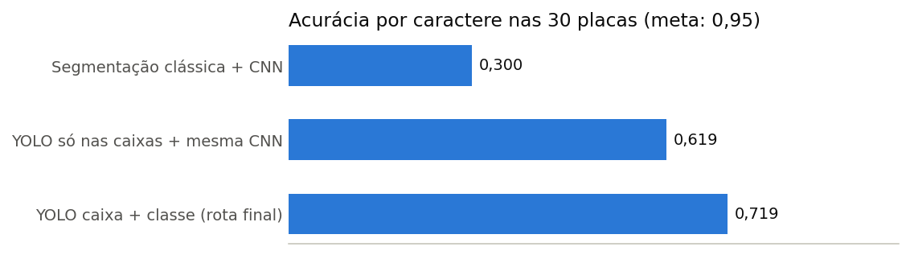
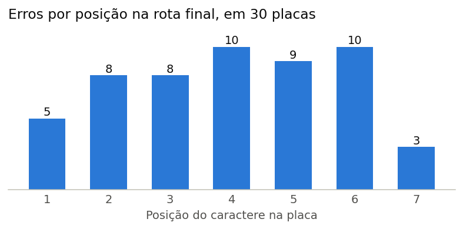

# ALPR Mercosul

Sistema que recebe a foto de um veículo e devolve o texto da placa. Nasceu como
trabalho final de Processamento e Análise de Imagens, na pós-graduação.

```
foto → [YOLO detecta a placa] → [recorte com margem de 8%]
     → [YOLO detecta e classifica os 7 caracteres]
     → [regra do formato brasileiro] → "ABC1D23"
```

## Resultados

| Métrica | Meta | Obtido |
| --- | --- | --- |
| mAP@0.5, detecção da placa (257 imagens de teste) | > 0,90 | **0,992** ✅ |
| mAP@0.5, detecção de caracteres (36 imagens de teste) | — | 0,931 |
| **Acurácia por caractere, fim a fim, 30 placas** | > 0,95 | **0,719** ❌ |
| **Acurácia por placa, fim a fim, 30 placas** | > 0,80 | **0,333** ❌ |

**Duas das três metas não foram atingidas.** O sistema lê corretamente 10 das 30
placas. Com tão poucas placas, cada uma vale 3,3 pontos de acurácia, então a medida
ainda é grosseira.

As tabelas de origem estão em `resultados/tabelas/`.

### O que a comparação mostrou: o gargalo era a segmentação



Mantendo a mesma CNN e trocando só a forma de localizar os caracteres, a acurácia por
caractere dobrou, de 0,300 para 0,619. Usar também a classe dada pelo YOLO levou a
0,719. Por isso o código hoje mantém só essa rota.

Esta comparação foi medida na versão entregue. Para refazê-la, use a tag
[`entrega-v1`](https://github.com/RLmagalhaes/alpr-mercosul-PAI-project/tree/entrega-v1).

### Onde a rota final erra



## Como rodar

```bash
git clone https://github.com/RLmagalhaes/alpr-mercosul-PAI-project.git
cd alpr-mercosul-PAI-project
python -m venv .venv && source .venv/bin/activate
pip install -r requirements.txt
pytest tests/ -v
```

Os testes não precisam de modelos. Para ler uma placa, é preciso ter os modelos em
`modelos/`:

```python
from src.leitor_yolo import LeitorDePlacasYOLO

leitor = LeitorDePlacasYOLO("modelos/detector_best.pt", "modelos/chars_best.pt")
print(leitor.ler("foto.jpg"))
```

Modelos e datasets não estão no repositório. Para obtê-los, rode os scripts de
`scripts/deteccao/` e `scripts/caracteres/`, que baixam os dados do Roboflow e treinam
em GPU. É preciso ter uma chave própria, fornecida em `ROBOFLOW_API_KEY`.

## Estrutura

```
├── src/                 o sistema: leitor, recorte, regra do formato e métricas
├── scripts/
│   ├── deteccao/        dados, treino e avaliação do detector de placas
│   ├── caracteres/      dados, treino e avaliação do detector de caracteres
│   └── leitor/          gabarito, avaliação fim a fim, limiar e figuras
├── tests/               testes das funções puras
├── resultados/          figuras e tabelas
└── docs/                armadilhas, decisões e o arquivo do trabalho entregue
```

O relatório completo está em [`docs/arquivo/RELATORIO.md`](docs/arquivo/RELATORIO.md).
O que falta fazer está nas [issues](https://github.com/RLmagalhaes/alpr-mercosul-PAI-project/issues).

## Dados

- **Detecção:** `trafficbr/vehicle-plate-color` v2 (Roboflow Universe), com 12.780 /
  960 / 257 imagens de veículos com a placa anotada.
- **Caracteres:** `project-swcsj/license-plate-character-extraction` v2, com cerca de
  33 mil caracteres anotados individualmente.
- **Avaliação:** 30 placas brasileiras (16 Mercosul, 14 no formato antigo), com texto
  transcrito e conferido por humano, em `resultados/tabelas/gabarito_mercosul.csv`.

## Privacidade

Placa veicular é um dado que pode identificar indiretamente uma pessoa. Este é um
exercício acadêmico, sem finalidade de vigilância ou rastreamento. Os resultados deste
repositório usam apenas conjuntos públicos, e nenhuma imagem foi coletada pelo autor.
O sistema produz apenas o texto da placa: não consulta, armazena nem cruza dados sobre
proprietário, veículo ou localização.

Com esta acurácia, o sistema **não deve ser usado para decisões automáticas sobre
pessoas**. Quando a confiança é baixa, ele devolve `revisao_manual` em vez de arriscar
um palpite.

## Licença

Uso acadêmico.
